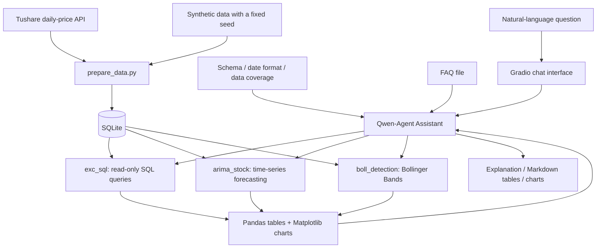

<div align="center">

# ChatBI · Stock Analytics Assistant

[简体中文](README.md) | [English](README.en.md)

**Ask questions in natural language. Explore the answers through data, tables, and charts.**

Natural-language analytics · SQL Agent · Tool Calling · Data Visualization


[Highlights](#highlights) · [Demo](#demo) · [Architecture](#architecture) · [Quick Start](#quick-start) · [Scope and Limitations](#scope-and-limitations)

</div>

## Recorded demo

**01:41** · Play inline or use the player's fullscreen control.

Ask for closing-price trends, Bollinger Band detection and ARIMA analysis; inspect tool calls, tables and charts in the conversation.

https://github.com/user-attachments/assets/2df7c68e-9bf1-4629-87d3-c4bde9e53164

**Approximate chapters:** `00:00` Natural-language query · `00:35` Bollinger Bands · `01:12` ARIMA analysis

<details>
<summary>Expand a screenshot from the recording</summary>


Captured from the author-provided recording. The application interface is in Chinese.

</details>

The recording uses the local data and interface available when recorded, separately from the fixed-seed synthetic charts below. Its data provenance and forecast performance are not independently verified here. It is not investment advice or an accuracy evaluation.

## Overview

Business questions start in natural language, but answering them often involves writing SQL, preparing data, calculating metrics, and building charts. ChatBI connects these steps through a conversational interface: the user asks a question, an agent selects a tool, and the database and analysis code produce results that can be inspected as tables and charts.

The project uses historical daily prices for Chinese A-share stocks to explore how **LLMs, structured data, and analytical tools** can work together. It is a runnable portfolio prototype demonstrating natural-language data access, agent tool orchestration, and an integrated analytics workflow.

> **About the data:** This repository does not distribute the developer's local market database. The three static tool charts in the Demo section use **synthetic data** generated with a fixed random seed; the recorded demo and its screenshot are described separately. Those synthetic charts do not represent actual stock performance. Company names demonstrate entity mapping only. The conversational interface requires your own model API key.

## Highlights

| Capability | User benefit | Implementation |
| --- | --- | --- |
| Natural-language queries | Describe a stock, date range, and metric in one question | Schema and date constraints in the prompt guide SQL generation |
| Tool orchestration | Query data, explore forecasts, and inspect indicators in one conversation | Three Qwen-Agent tools with explicit parameter definitions |
| Tables and charts | Inspect values, descriptive statistics, and trends together | Pandas for data processing; Matplotlib for charts |
| Time-series demonstration | Compare historical prices with model projections | ARIMA(5,1,5), using up to the latest 252 records |
| Bollinger Band detection | Identify closes outside the bands and measure their deviations | A 20-day rolling mean and standard deviation, with ±2σ bands |
| Reproducible offline demo | Run all three analysis tools without an API key | Synthetic data with a fixed seed and `python demo.py` |
| Read-only analysis | Restrict database access from analysis tools | SQLite read-only mode, query-only settings, and an authorizer callback |

## Demo

These charts are actual outputs from the project's analysis tools and can be reproduced with `python demo.py`. They demonstrate tool execution; they are not evidence of measured natural-language query accuracy.

The application currently uses Chinese prompts, tool messages, and chart labels. This document provides English documentation; a fully localized English interface is not implemented.

### Bollinger Bands: locating price breaks


The tool also returns the date, closing price, band value, and percentage deviation for each detected break. “Overbought” and “oversold” are indicator labels, not trading recommendations.

<details>
<summary>View SQL query and ARIMA forecast examples</summary>

**SQL query and visualization:** Retrieve a quarter of closing prices from the demo dataset and return a table, descriptive statistics, and a trend chart.


**ARIMA demonstration:** Use the latest historical observations in the database to generate projections for the next seven weekdays.


Forecast dates follow a Monday-to-Friday calendar and do not account for exchange holidays. The fixed-parameter model may fail to converge; backtesting and forecast error evaluation have not yet been implemented.

</details>

### Example questions

The English questions below illustrate the intended requests. English-language query accuracy has not been benchmarked; the Chinese README contains the original example prompts.

| Question | Expected tool | Output |
| --- | --- | --- |
| Show the closing-price trend for Kweichow Moutai (600519.SH) in January 2025. | `exc_sql` | Dates, closing prices, statistics, and a chart |
| What was the average daily trading volume for GF Securities (000776.SZ) in April 2025? | `exc_sql` | An aggregate result |
| Compare the 2025 price changes of SMIC (688981.SH) and Kweichow Moutai (600519.SH). | `exc_sql` | A comparison based on the first and last closing prices in the period |
| Using the latest available data, forecast the next seven weekdays for Wuliangye (000858.SZ). | `arima_stock` | A projection table and historical/forecast curves |
| Find Bollinger Band breaks for Hikvision (002415.SZ) in 2025. | `boll_detection` | Break dates, deviations, and an annotated chart |

Answer quality depends on the model's query generation and tool selection. These examples describe the intended workflow, not a guarantee of accuracy.

## Architecture



The model interprets questions, generates SQL, and selects tools. The database and Python tools execute queries and calculations. Qwen-Agent handles tool routing; there is no separately trained routing model.

## Quick Start

### 1. Set up the environment

Clone the repository and enter the project directory:

```bash
git clone https://github.com/SimonLecake/chatbi-stock-assistant.git
cd chatbi-stock-assistant
```

The application was developed and checked locally with **Python 3.11 on Windows**.

**Windows PowerShell:**

```powershell
python -m venv .venv
.\.venv\Scripts\Activate.ps1
python -m pip install -r requirements.txt
Copy-Item .env.example .env
```

**macOS / Linux:**

```bash
python3 -m venv .venv
source .venv/bin/activate
python -m pip install -r requirements.txt
cp .env.example .env
```

Charts currently use Chinese labels. If the configured fonts are unavailable, install a Chinese-capable font and update the font settings in `app.py`.

### 2. Try the offline demo — no API key required

```bash
python demo.py
```

The demo creates 1,827 synthetic daily records across seven stocks in a temporary database, calls all three analysis tools directly, and saves PNG charts and Markdown results to `demo_output/`. It does not call an LLM or market-data API and does not overwrite an existing database.

### 3. Start the conversational interface

Add your own DashScope API key to `.env`:

```dotenv
DASHSCOPE_API_KEY=your_own_key
CHATBI_MODEL=qwen-max
CHATBI_DB_PATH=stock_prices.db
CHATBI_PORT=7861
```

Create a demo database and launch the app:

```bash
python prepare_data.py --demo
python app.py
```

Open **http://127.0.0.1:7861** and ask a question. The synthetic dataset covers 2025. The application supplies the agent with the dataset type and date coverage.

If the target database already exists, the preparation script stops to prevent overwriting it. To use a different file, run `python prepare_data.py --demo --db demo.db` and set `CHATBI_DB_PATH=demo.db` in `.env`.

### 4. Optional: use real historical market data

Set your own `TUSHARE_TOKEN` in `.env`, then choose a new database file:

```bash
python prepare_data.py --start 20250101 --end 20251231 --db market.db
```

Change `CHATBI_DB_PATH` to `market.db` in `.env` and restart the app. Data access and API quotas depend on your data-provider account. Downloaded databases are ignored by Git by default.

## Implementation

| Layer | Technology | Responsibility |
| --- | --- | --- |
| Interface | Qwen-Agent WebUI / Gradio | Multi-turn chat, suggested questions, and result display |
| Model | DashScope / Qwen | Question interpretation, SQL generation, and tool selection |
| Data | SQLite / Pandas | Historical data storage, querying, and result processing |
| Analysis | Statsmodels / NumPy / Pandas | ARIMA modeling, rolling indicators, and break detection |
| Presentation | Matplotlib / Markdown | Charts and readable results |
| Ingestion | Tushare / synthetic data generator | Real-data ingestion and reproducible demos |

### Design decisions

- **Explicit date constraints:** The database stores dates as `YYYYMMDD` text. The prompt specifies this format to reduce empty results caused by mismatched date conditions.
- **Calculations executed by tools:** The model selects a tool, and the tool returns computed results that can be inspected against the underlying data.
- **Visible data coverage:** The agent receives the database's date range. Forecasts start from the latest stored observation, helping distinguish historical data from live market information.
- **Read-only analysis connections:** Query connections reject writes, database attachment, and PRAGMA changes. Query timeouts, complexity limits, and multi-user permissions are not yet implemented.
- **Reproducible demonstrations:** A fixed seed and fixed dates produce repeatable data. The offline demo uses a temporary database and requires neither the developer's database nor credentials.

## Repository Structure

```text
.
├── app.py                    # Agent, three analysis tools, and WebUI
├── db.py                     # Configuration, data coverage, and read-only access
├── prepare_data.py           # Synthetic data generation / Tushare ingestion
├── demo.py                   # Offline tool demo; no API key required
├── faq.txt                   # Example definition of period price change
├── requirements.txt          # Dependency versions
├── .env.example              # Configuration template without credentials
├── tests/test_data.py        # Data integrity, overwrite protection, read-only tests
├── docs/assets/              # Synthetic-data charts used in the READMEs
└── .github/workflows/        # Compilation checks and data-layer tests
```

## Validation

```bash
python -m unittest discover -s tests -v
python demo.py
```

Automated tests check reproducibility, stock and record counts, protection of existing databases, unique stock/date pairs, and rejection of writes and database attachment. The offline demo checks that all three tools produce Markdown results and actual image files.

GitHub Actions runs syntax checks and data-layer tests without calling paid APIs. These checks do not validate a complete dependency installation, natural-language answer accuracy, or browser interactions end to end.

## Scope and Limitations

- **Query correctness:** Read-only access prevents modifications but does not guarantee that generated SQL matches the user's intent. A metric semantic layer and a query evaluation dataset are still needed.
- **Visualization:** General query charts use at most ten evenly spaced samples. This provides an overview but can omit local fluctuations. Single-row aggregate results are displayed as tables only.
- **Forecasting:** ARIMA uses fixed parameters. Rolling backtests, baseline comparisons, and confidence-interval displays are not implemented. Forecasts demonstrate the statistical method only.
- **Knowledge retrieval:** One FAQ file is connected. Research-report parsing, announcement retrieval, page-level citations, and combined SQL/document answers are not implemented.
- **Deployment:** The app binds to localhost by default and is intended for personal demonstrations. Multi-user authentication, concurrent plotting isolation, query resource limits, and monitoring remain future work.
- **Data:** Synthetic records follow weekdays rather than an actual exchange calendar. Users must obtain real market data themselves. The project does not provide live prices or investment advice.

## Roadmap

- [ ] Build an evaluation dataset with natural-language questions, reference SQL, and expected results.
- [ ] Add consistent metric definitions, query timeouts, and error recovery.
- [ ] Improve long-series chart sampling, multi-stock comparisons, and full-result exports.
- [ ] Add data refresh, an exchange calendar, forecast backtesting, and error reporting.
- [ ] Retrieve research reports and announcements with traceable source references.
- [ ] Separate tool modules and improve support for multiple users.

## Acknowledgments

The project builds on Qwen-Agent's agent and WebUI capabilities and uses Pandas, Matplotlib, Statsmodels, SQLite, DashScope, and Tushare. Its portfolio focus is the integration of these components into a concrete analytics workflow, the implementation of analysis tools, and the associated engineering decisions.
