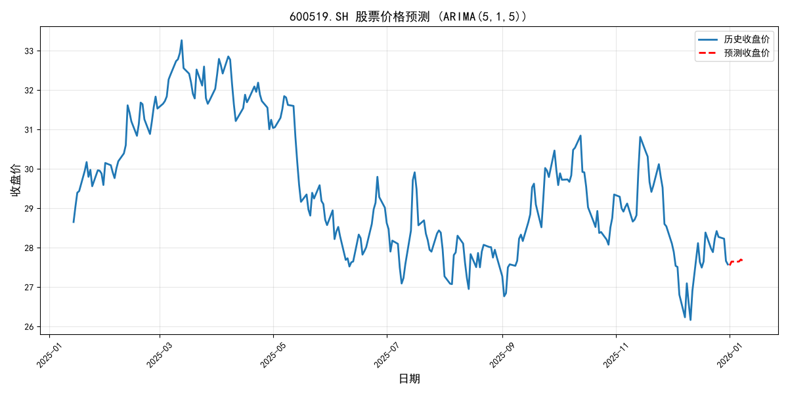
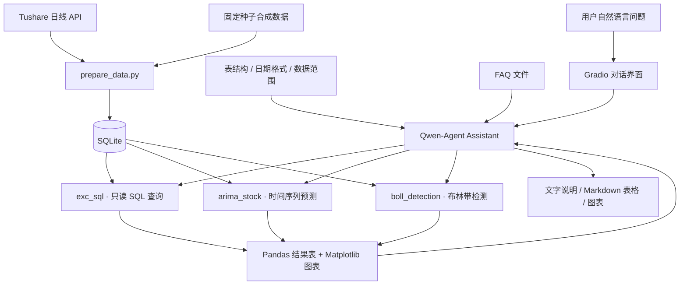

<div align="center">

# ChatBI · 股票数据分析助手

[简体中文](README.md) | [English](README.en.md)

**用自然语言查询数据，让分析结果以表格和图表呈现。**

Natural-language analytics · SQL Agent · Tool Calling · Data Visualization


[项目亮点](#项目亮点) · [效果展示](#效果展示) · [系统架构](#系统架构) · [快速开始](#快速开始) · [设计与边界](#设计与边界)

</div>

## 项目简介

业务问题通常以自然语言提出，但答案往往需要经历写 SQL、整理数据、计算指标和绘图。ChatBI 将这些步骤连接到一个对话入口：用户描述问题，Agent 选择工具，数据库和统计程序完成计算，最后返回可检查的表格与图表。

项目以 A 股历史日线数据为场景，探索 **LLM + 结构化数据 + 分析工具** 的协作方式。当前定位是可运行的个人作品集原型，用于展示自然语言取数、Agent 工具编排和数据分析流程的工程实现。

> **数据说明**：本仓库不分发本地真实行情数据库。README 中的图表来自固定随机种子生成的**合成数据**，不代表任何股票的真实走势；股票名称仅用于演示实体映射。对话功能需要用户自行配置模型 API Key。

## 项目亮点

| 能力 | 用户获得什么 | 实现方式 |
| --- | --- | --- |
| 自然语言取数 | 用一句话描述股票、时间范围和统计需求 | 表结构与日期约束注入 Prompt，Agent 生成 SQL |
| 工具编排 | 在同一对话中完成查询、预测与指标分析 | Qwen-Agent 注册三个具有明确参数的工具 |
| 表格与图表输出 | 同时查看具体数值、描述统计和走势 | Pandas 处理结果，Matplotlib 生成图片 |
| 时间序列方法演示 | 观察历史序列与模型外推结果 | ARIMA(5,1,5)，使用最近最多 252 条记录 |
| 布林带检测 | 找到收盘价突破上下轨的日期与偏离程度 | 20 日滚动均值、标准差及 ±2σ 区间 |
| 可复现的离线演示 | 无需 API Key 即可运行三个分析工具 | 固定种子合成数据 + `python demo.py` |
| 数据访问边界 | 分析工具使用只读数据库连接 | SQLite 只读模式、查询限制及授权回调 |

## 效果展示

以下图片由项目中的分析工具实际生成，可通过 `python demo.py` 复现。它们展示工具输出，不代表已经完成自然语言对话准确率评测。

### 布林带检测：从走势中定位突破点


工具同时输出突破日期、收盘价、对应轨道值与偏离比例。这里的“超买 / 超卖”是指标标签，不等同于买卖结论。

<details>
<summary>展开查看 SQL 查询与 ARIMA 预测效果</summary>

**SQL 查询与可视化**：查询演示数据中某只股票的季度收盘价，返回表格、描述统计和走势图。


**ARIMA 方法演示**：根据数据库中最近的历史序列，生成后续 7 个工作日的模型输出。



预测日期按周一至周五推算，未接入交易所节假日日历。固定参数模型可能出现不收敛警告，尚未进行回测或误差评估。

</details>

### 可以这样提问

| 自然语言问题 | 预期调用 | 输出 |
| --- | --- | --- |
| 查询贵州茅台 2025 年 1 月的收盘价走势 | `exc_sql` | 日期、收盘价、统计信息及图表 |
| 统计广发证券 2025 年 4 月的日均成交量 | `exc_sql` | 聚合统计结果 |
| 对比中芯国际和贵州茅台 2025 年的区间涨跌幅 | `exc_sql` | 按区间首尾收盘价计算的对比结果 |
| 基于数据库最新数据，预测五粮液之后 7 个工作日的价格 | `arima_stock` | 模型输出表与历史 / 预测曲线 |
| 检测海康威视 2025 年的布林带突破点 | `boll_detection` | 突破点明细、偏离比例及标记图 |

实际回答质量依赖模型生成的查询和工具选择；这些示例是使用入口，不是准确率承诺。

## 系统架构



模型承担问题理解、SQL 生成与工具选择；数据库和 Python 工具执行查询与计算。工具路由由 Qwen-Agent 完成，当前没有单独训练的路由模型。

## 快速开始

### 1. 安装环境

下载仓库或使用 GitHub 页面上的 **Code → Clone**，进入项目根目录。开发验证环境为 **Python 3.11 / Windows**。

```powershell
python -m venv .venv
.\.venv\Scripts\Activate.ps1
python -m pip install -r requirements.txt
Copy-Item .env.example .env
```

macOS / Linux 可使用：

```bash
python3 -m venv .venv
source .venv/bin/activate
python -m pip install -r requirements.txt
cp .env.example .env
```

在 Linux 上显示中文图表需要安装可用的中文字体，并相应调整 `app.py` 中的字体配置。

### 2. 先运行不需要密钥的离线演示

```bash
python demo.py
```

程序在临时数据库中生成 7 只股票、1,827 条合成日线记录，直接调用三个工具，将 PNG 图表和 Markdown 结果保存到 `demo_output/`。此流程不调用模型或行情 API，不覆盖现有数据库。

### 3. 启动自然语言对话

编辑 `.env`，填写自己的 DashScope API Key：

```dotenv
DASHSCOPE_API_KEY=your_own_key
CHATBI_MODEL=qwen-max
CHATBI_DB_PATH=stock_prices.db
CHATBI_PORT=7861
```

创建演示数据库并启动：

```bash
python prepare_data.py --demo
python app.py
```

打开 **http://127.0.0.1:7861**，输入上面的示例问题。演示数据覆盖 2025 年；应用会向 Agent 提供数据类型和覆盖日期。

若目标数据库已存在，数据准备脚本会停止，避免覆盖数据。可改用 `python prepare_data.py --demo --db demo.db`，并设置 `CHATBI_DB_PATH=demo.db`。

### 4. 可选：接入真实历史行情

在 `.env` 中配置自己的 `TUSHARE_TOKEN`，然后选择一个新的数据库文件：

```bash
python prepare_data.py --start 20250101 --end 20251231 --db market.db
```

将 `.env` 中的 `CHATBI_DB_PATH` 改为 `market.db` 后重新启动应用。数据可用范围和调用额度取决于自己的数据服务账号；下载后的数据库默认被 Git 忽略。

## 技术实现

| 层次 | 技术 | 职责 |
| --- | --- | --- |
| 交互层 | Qwen-Agent WebUI / Gradio | 多轮对话、示例问题与结果展示 |
| 模型层 | DashScope / Qwen | 理解问题、生成 SQL、选择工具 |
| 数据层 | SQLite / Pandas | 历史行情存储、查询与结果整理 |
| 分析层 | Statsmodels / NumPy / Pandas | ARIMA 建模、滚动指标与异常点筛选 |
| 展示层 | Matplotlib / Markdown | 图表和可读结果输出 |
| 数据准备 | Tushare / 合成数据生成器 | 真实数据接入及无密钥演示 |

### 关键设计取舍

- **约束日期表达**：数据库使用 `YYYYMMDD` 文本日期，在 Prompt 中明确格式，减少条件不匹配造成的空结果。
- **以工具完成计算**：模型选择工具，工具返回计算结果，便于检查分析过程中的数据依据。
- **明确历史数据边界**：向 Agent 注入数据库的覆盖日期；预测基于库中最新记录，避免把旧数据当成实时行情。
- **只读分析连接**：禁止通过查询连接写入数据、附加数据库或修改 PRAGMA。当前尚无查询超时、复杂度限制和多用户权限体系。
- **演示可复现**：固定随机种子和日期，使用独立临时库验证工具，不分发开发者本地数据库与密钥。

## 仓库结构

```text
.
├── app.py                    # Agent、三个分析工具与 WebUI
├── db.py                     # 环境配置、数据范围与只读连接
├── prepare_data.py           # 合成数据 / Tushare 数据准备
├── demo.py                   # 无需 API Key 的离线工具演示
├── faq.txt                   # 区间涨跌幅计算口径示例
├── requirements.txt          # 依赖版本
├── .env.example              # 配置模板，不包含真实密钥
├── tests/test_data.py        # 数据完整性、覆盖保护、只读访问测试
├── docs/assets/              # README 中的合成数据演示图
└── .github/workflows/        # 编译与数据层测试
```

## 验证方式

```bash
python -m unittest discover -s tests -v
python demo.py
```

自动化测试覆盖：合成数据可复现、股票数量与记录数、已有数据库不被覆盖、股票 / 日期唯一约束、分析连接拒绝写入和附加数据库。离线演示检查三个工具能生成 Markdown 结果及实际图片文件。

GitHub Actions 执行语法检查和数据层测试；不调用收费 API，也不代表完整依赖安装、自然语言回答或浏览器交互已经通过端到端验证。

## 设计与边界

- **查询正确性**：只读连接限制修改行为，但不保证模型生成的 SQL 符合用户意图。指标语义层和查询评测集仍待补充。
- **可视化**：当前通用查询图最多等间距采样 10 个点，便于概览，但可能丢失局部波动；单行聚合结果仅显示表格。
- **预测**：ARIMA 使用固定参数，尚无滚动回测、基线比较和置信区间展示；输出仅用于统计方法演示。
- **知识库**：已接入一个 FAQ 文件。研报 / 公告解析、来源页码引用和 SQL + 文档联合回答尚未实现。
- **部署范围**：默认绑定本机地址，适合个人演示。多用户鉴权、并发绘图隔离、查询资源限制和服务监控仍待完善。
- **数据边界**：合成数据按工作日生成，不模拟真实交易日历；真实行情需要用户自行获取。项目不提供实时行情或投资建议。

## 后续计划

- [ ] 建立自然语言问题、参考 SQL 与预期结果的评测集。
- [ ] 增加统一指标口径、查询超时和错误恢复机制。
- [ ] 改善长序列图表采样、多股票对比与完整结果导出。
- [ ] 增加数据更新、交易日历、预测回测和误差展示。
- [ ] 接入研报 / 公告检索，并为回答附上可追溯来源。
- [ ] 拆分工具模块，完善多用户服务能力。

## 致谢

项目基于 Qwen-Agent 的 Agent 与 WebUI 能力，并使用 Pandas、Matplotlib、Statsmodels、SQLite、DashScope 和 Tushare 等工具与服务。作品集展示的重点是这些组件在具体分析流程中的集成、工具实现与工程取舍。
